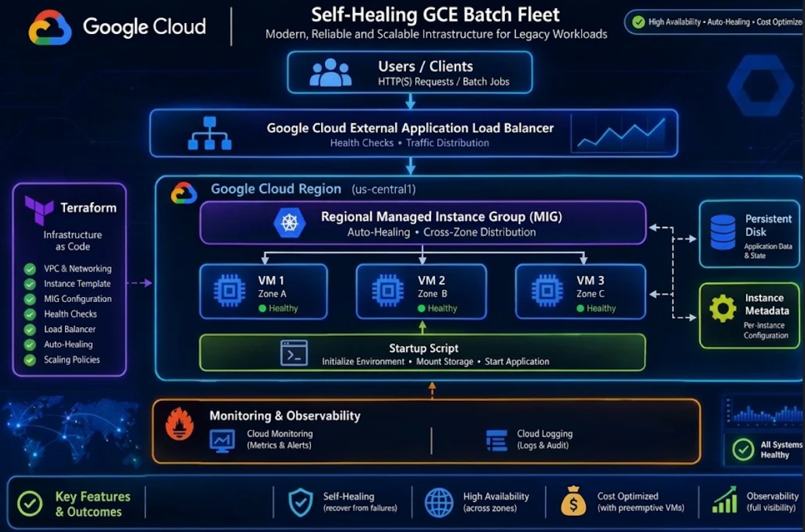
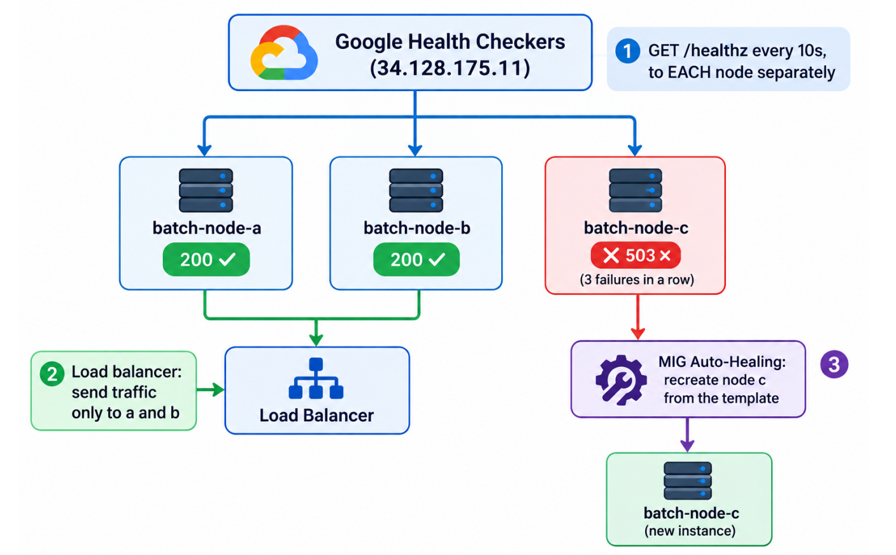

# GCE Legacy Batch Fleet

A self-healing Google Compute Engine fleet for a legacy batch application that cannot be containerised. Every VM is built from one Terraform-managed template, configures itself at boot from instance metadata, and is replaced automatically when it stops responding.



## How it works

- **Instance template:** Ubuntu 22.04 on `e2-standard-2`, a separate 50 GB data disk, no public IP, Shielded VM, and a log/metric-only service account.
- **Startup script:** runs every boot. Updates packages, formats the data disk on first boot only, mounts it via `/etc/fstab`, reads settings from the metadata server, and starts the batch app with a `/healthz` endpoint.
- **Regional MIG:** three nodes across `us-central1-a`, `-b` and `-c`. Data disks and per-node settings survive recreation.
- **Auto-healing:** `/healthz` is probed every 10 seconds. After three failures a node leaves the load balancer and the MIG recreates it.
- **Load balancer:** global external Application Load Balancer, round robin across healthy nodes.
- **Metadata:** fleet-wide environment variables, plus a unique shard and role per node.
- **Networking:** Cloud NAT for outbound updates; SSH only through IAP.



## Phases

| # | Phase | Doc |
|---|---|---|
| 1 | Project setup and Terraform auth | [01](docs/01-project-setup.md) |
| 2 | Instance template | [02](docs/02-instance-template.md) |
| 3 | Startup script | [03](docs/03-startup-script.md) |
| 4 | Managed Instance Group | [04](docs/04-managed-instance-group.md) |
| 5 | Load balancing and health checks | [05](docs/05-load-balancing.md) |
| 6 | Metadata integration | [06](docs/06-metadata-integration.md) |
| 7 | Verification and stress testing | [07](docs/07-verification.md) |

## Verified behaviour

- A deleted VM was restored by the MIG.
- A VM whose app stopped was marked unhealthy and replaced by auto-healing.
- The load balancer kept serving from the other zones throughout.
- **Stretch goals:** Spot VMs and cross-zone distribution.

Evidence is in [`screenshots/`](screenshots/).

## Repository layout

```
terraform/   Terraform per phase (phase-07 is final)
scripts/     Setup, verification and failure tests
docs/        One document per phase
screenshots/ Evidence
```

## Quick start

```bash
cd terraform/phase-07/terraform
terraform init
terraform apply
../../../scripts/phase-07/chaos.sh baseline
```

Credentials and `*.tfvars` are never committed.

## Cleanup

```bash
terraform destroy
../../../scripts/phase-07/cleanup-check.sh
```