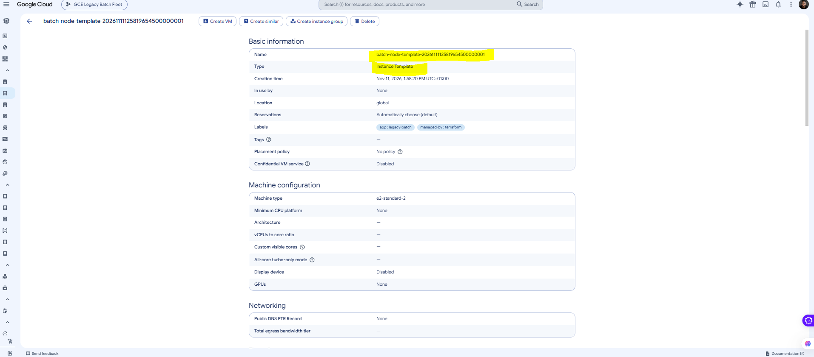
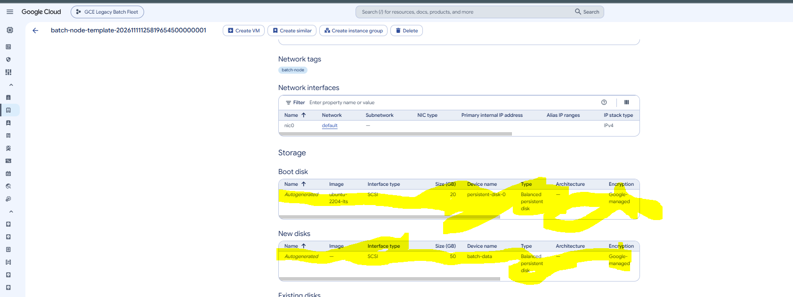

# Phase 2: Instance Template

## Objective
Define a single, versioned blueprint for every batch node in Terraform: machine
type, Ubuntu 22.04 LTS boot disk, a dedicated persistent data disk, network
tags and a least-privilege runtime identity. The Managed Instance Group in
Phase 4 builds every VM from this template, so anything wrong here is wrong on
every node.

## What Was Built
- `google_compute_instance_template.batch_node` in `terraform/main.tf`
- An Ubuntu 22.04 LTS boot disk (20 GB, `pd-balanced`)
- A separate 50 GB `pd-balanced` data disk per instance, exposed as `/dev/disk/by-id/google-batch-data`
- Network tag `batch-node` for firewall targeting
- No external IP on the nodes
- A dedicated runtime service account, `batch-node-sa`, limited to writing logs and metrics
- Shielded VM (Secure Boot, vTPM, integrity monitoring) and OS Login enabled
- Template variables in `terraform/variables.tf` and outputs in `terraform/outputs.tf`

## Configuration

### Instance template

| Item | Value |
|---|---|
| Resource | `google_compute_instance_template.batch_node` |
| Name | `batch-node-template-20261111125819654500000001` (from `name_prefix`) |
| Machine type | `e2-standard-2` (2 vCPU, 8 GB) |
| Network | `default` |
| External IP | None |
| Network tags | `batch-node` |
| Labels | `app=legacy-batch`, `managed-by=terraform` |
| Lifecycle | `create_before_destroy = true` |

**Why `e2-standard-2` instead of the starter's `e2-medium`?** `e2-medium` is a
shared-core machine that bursts above its baseline and then gets throttled.
That is fine for a web server but bad for a batch job that keeps the CPU busy
for minutes at a time. `e2-standard-2` gives 2 dedicated vCPUs and 8 GB. It
uses the same vCPU count, so three nodes still fit inside the free trial's
8 vCPU cap with room for a replacement during auto-healing.

**Why `name_prefix` and `create_before_destroy`?** Instance templates cannot be
edited. Any change creates a new template. With a fixed name, Terraform would
try to delete the old template first, which fails once a MIG is using it.
`name_prefix` gives each version a unique name, and `create_before_destroy`
creates the new one before removing the old one.

### Disks

| Item | Boot disk | Data disk |
|---|---|---|
| Image | `ubuntu-os-cloud/ubuntu-2204-lts` | None (blank) |
| Type | `pd-balanced` | `pd-balanced` |
| Size | 20 GB | 50 GB |
| Device name | `persistent-disk-0` (assigned by GCE) | `batch-data` |
| Path on VM | `/dev/disk/by-id/google-persistent-disk-0` | `/dev/disk/by-id/google-batch-data` |
| Auto-delete | Yes | Yes |

**Why a separate data disk?** Batch input and output stay off the OS disk. The
boot disk can be rebuilt from the image at any time, while the data disk has
its own size, type and lifecycle. It also gives the startup script in Phase 3
a clear job: find this disk, format it on first boot only, and mount it.

**Why the `device_name`?** Linux names like `/dev/sdb` depend on attach order
and can change. `device_name = "batch-data"` makes GCE publish a stable symlink
at `/dev/disk/by-id/google-batch-data`, so the startup script never guesses.

**Why the image family instead of a fixed image?** `ubuntu-2204-lts` resolves
to the newest patched 22.04 image when the template is created. Each new
template version picks up security patches without changing code.

### Runtime service account

| Item | Value |
|---|---|
| Name | `batch-node-sa` |
| Email | `batch-node-sa@legacy-batch-fleet-8693.iam.gserviceaccount.com` |
| Roles | `roles/logging.logWriter`, `roles/monitoring.metricWriter` |
| Created by | `scripts/phase-02/create-node-sa.sh`, run as the project owner |

**Why not the default Compute Engine service account?** In a project without
an organization policy, the default compute SA has project Editor. Any process
on any batch node could then change almost anything in the project. The nodes
only need to send logs and metrics, so that is all they get.

**Why create it outside Terraform?** Creating a service account and granting it
roles needs IAM admin permissions. Giving those to the Terraform SA would let
it grant itself any role. The node SA is created once by the owner, and
Terraform only attaches it, which `roles/iam.serviceAccountUser` from Phase 1
already allows.

### Security hardening

| Setting | Value | Purpose |
|---|---|---|
| Shielded VM Secure Boot | On | Only signed boot components load |
| vTPM | On | Measured boot |
| Integrity monitoring | On | Alerts if the boot sequence changes |
| `enable-oslogin` | `TRUE` | SSH access controlled by IAM, not by keys in metadata |

### Cost

| Item | Value |
|---|---|
| Resources created | 1 instance template |
| Cost | $0. A template is a blueprint; no VMs or disks exist yet |
| First billable resources | Phase 3 (test VM and Cloud NAT) |

### Commands
The full command set is in [`scripts/phase-02/`](../scripts/phase-02/) and
[`terraform/`](../terraform/):

| File | What it does |
|---|---|
| [`main.tf`](../terraform/main.tf) | Defines `google_compute_instance_template.batch_node` |
| [`variables.tf`](../terraform/variables.tf) | Machine type, image, disk sizes and types, network, tags, node SA |
| [`outputs.tf`](../terraform/outputs.tf) | Template name, self link and node SA email |
| [`create-node-sa.sh`](../scripts/phase-02/create-node-sa.sh) | Creates `batch-node-sa` and grants log and metric writer roles |
| [`plan-summary.sh`](../scripts/phase-02/plan-summary.sh) | Prints a one-screen summary of a saved plan |
| [`verify.sh`](../scripts/phase-02/verify.sh) | Describes the created template for the checks below |

```bash
./scripts/phase-02/create-node-sa.sh
terraform -chdir=terraform fmt
terraform -chdir=terraform validate
terraform -chdir=terraform plan -out=phase2.tfplan
./scripts/phase-02/plan-summary.sh
terraform -chdir=terraform apply phase2.tfplan
./scripts/phase-02/verify.sh
```

## Verification

| Check | Command | Result |
|---|---|---|
| Node SA roles | `./scripts/phase-02/create-node-sa.sh` (prints roles at the end) | `roles/logging.logWriter`, `roles/monitoring.metricWriter` |
| Config is valid | `terraform validate` | `Success! The configuration is valid.` |
| Plan adds one resource | `./scripts/phase-02/plan-summary.sh` | `Plan: 1 to add, 0 to change, 0 to destroy.` |
| Template created | `terraform -chdir=terraform apply phase2.tfplan` | `Apply complete! Resources: 1 added`; template `batch-node-template-20261111125819654500000001` |
| Ubuntu 22.04 boot disk | `./scripts/phase-02/verify.sh` (`sourceImage`) | `projects/ubuntu-os-cloud/global/images/family/ubuntu-2204-lts`, 20 GB `pd-balanced` |
| Data disk attached | `./scripts/phase-02/verify.sh` (`deviceName: batch-data`, 50 GB) | `deviceName: batch-data`, `diskSizeGb: '50'`, `pd-balanced`, no `sourceImage` (blank) |
| Network tag | `./scripts/phase-02/verify.sh` (`tags: batch-node`) | `tags.items: [batch-node]` |
| No external IP | `./scripts/phase-02/verify.sh` (no `accessConfigs`) | `nic0` on `default` with no `accessConfigs` |
| Runtime SA | `./scripts/phase-02/verify.sh` (`batch-node-sa@...`) | `batch-node-sa@legacy-batch-fleet-8693.iam.gserviceaccount.com` |

### Screenshots

**Terraform plan**


**Instance template: machine type and network tags**


**Instance template: boot and data disks**


## Notes & Issues

### Issue: project not set in a new Cloud Shell session
**Symptom**
```
No project set. Run: export PROJECT_ID=your-project-id
```

**Cause:** Cloud Shell keeps files in `$HOME` between sessions, but every new
session starts a fresh shell. The exported `PROJECT_ID` and the gcloud default
project from the previous session were gone.

**Fix:**
```bash
gcloud config set project legacy-batch-fleet-8693
echo 'export PROJECT_ID=legacy-batch-fleet-8693' >> ~/.bashrc
echo 'gcloud config set project legacy-batch-fleet-8693 >/dev/null 2>&1' >> ~/.bashrc
source ~/.bashrc
```

**Lesson:** Anything a Cloud Shell session depends on has to live in a file
under `$HOME`, such as `~/.bashrc`, or it will not be there tomorrow.

### Issue: zip unpacked into the home directory instead of the repo
**Symptom**
```
Error handling -chdir option: chdir terraform: no such file or directory
```

**Cause:** `unzip` was run from `~`, so the archive created `~/scripts` and
`~/docs` instead of updating the repo. `terraform -chdir=terraform` then looked
for `~/terraform`, which does not exist.

**Fix:**
```bash
cd ~/gce-legacy-batch-fleet
unzip -o ~/phase02-files.zip
rm -rf ~/scripts ~/docs
```

**Lesson:** `unzip` extracts relative to the current directory. `cd` into the
repo root first.

### Issue: apply run from a stale copy of the repo
**Symptom**
```
Error: Failed to load "phase2.tfplan" as a plan file
Error: stat phase2.tfplan: no such file or directory
-bash: ./scripts/phase-02/verify.sh: No such file or directory
```

**Cause:** An older unzipped copy of the repo,
`~/gce-legacy-batch-fleet-phase01/gce-legacy-batch-fleet`, was still in Cloud
Shell. The apply ran there, where neither the plan file nor the Phase 2 scripts
existed.

**Fix:** Returned to `~/gce-legacy-batch-fleet`, re-ran the apply, then deleted
the stale copy after confirming it held no key or state:
```bash
rm -rf ~/gce-legacy-batch-fleet-phase01 ~/gce-legacy-batch-fleet-phase01.zip
```

**Lesson:** Keep exactly one working copy. Two copies with the same layout make
it easy to run a command in the wrong one, and with Terraform that can mean the
wrong state file.

### Decision: plan summary script for review evidence
The raw `terraform plan` output for an instance template runs to several
screens, so one screenshot cannot show both the disks and the
`Plan: 1 to add` line. `plan-summary.sh` reads the saved plan with
`terraform show -json` and prints only the reviewed fields. It reads the same
plan file that `terraform apply` uses, so the summary always matches what
actually gets applied.

### Decision: no VMs in this phase
An instance template is only a blueprint. Applying it creates no VMs and costs
nothing. The first billable resources appear in Phase 3, when a test VM is
built from this template to prove the startup script works.

### Decision: no external IPs on nodes
Batch nodes are not meant to be reached directly. Inbound traffic will come
through the load balancer in Phase 5. Without public IPs, the nodes also cannot
reach the internet on their own, so Phase 3 adds Cloud NAT before the startup
script runs `apt-get update`.

### Decision: data disk survives VM restarts but not recreation (yet)
With `auto_delete = true`, the data disk survives reboots and live migration
but is deleted when the MIG recreates an instance during auto-healing. Phase 4
revisits this with a stateful disk policy so the disk is kept and reattached to
the replacement VM.