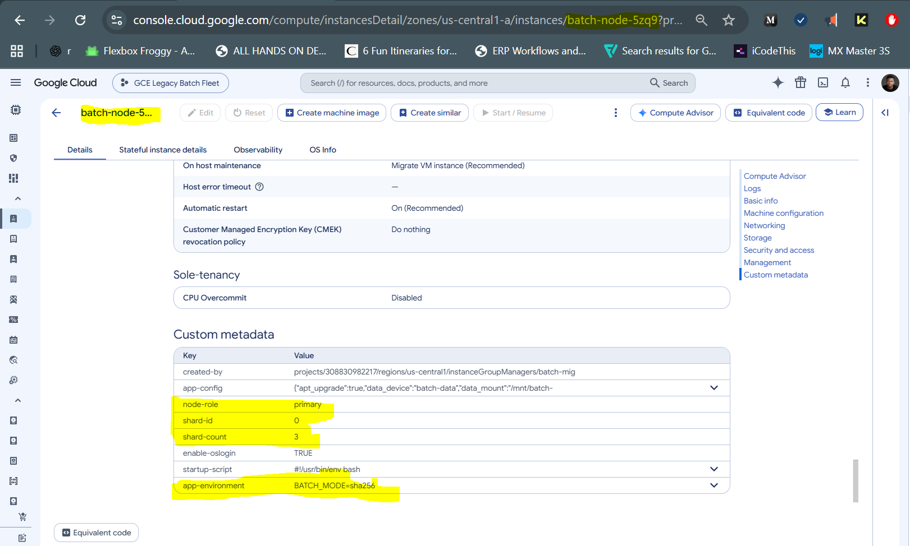
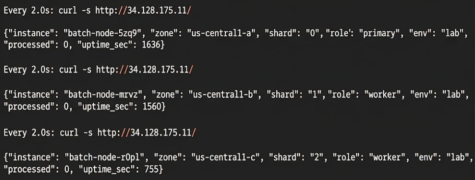

# Phase 6: Instance Metadata Integration

## Objective
Configure the batch application entirely from instance metadata, with nothing
baked into the image: shared environment variables for the whole fleet, plus
values that are unique to each node. The startup script reads both at boot and
writes them into the application's environment. The new configuration is
rolled out one node at a time so the load balancer keeps serving throughout.

## What Was Built
- `app-environment` metadata key on the instance template, generated from the Terraform map `app_environment`
- `shard-count` metadata key on the template, set from `target_size`
- Per-instance configs on `batch-mig` giving each node its own `shard-id` and `node-role` (stateful metadata)
- Startup script changes: reads the new keys, validates environment variable names, blocks overrides of reserved keys, writes everything to `/etc/batch-app/app.env`
- Application changes: `/` reports the node's shard and role; `/config` returns node identity, `app-config` and the injected environment
- `scripts/phase-06/rollout.sh`: assigns per-node metadata and replaces nodes one at a time, waiting for each to be healthy
- `scripts/phase-06/verify.sh`: shows the metadata on each VM, what each node applied, and responses through the load balancer

## Configuration

### Three layers of configuration

| Layer | Where it is set | Keys | Same on every node? |
|---|---|---|---|
| Instance-level, set by GCE | The metadata server, automatically | `instance/name`, `instance/zone`, `instance/id`, `network-interfaces/0/ip` | No |
| Fleet-wide | Instance template metadata (Terraform) | `app-config`, `app-environment`, `shard-count`, `startup-script` | Yes |
| Per instance | MIG per-instance configs (stateful metadata) | `shard-id`, `node-role` | No |

The startup script reads all three from `http://metadata.google.internal` with
the `Metadata-Flavor: Google` header, then writes one environment file that
the `batch-app` service loads.

### Fleet-wide environment variables

Defined once in `variables.tf`:

```hcl
variable "app_environment" {
  type = map(string)
  default = {
    LOG_LEVEL     = "INFO"
    BATCH_MODE    = "sha256"
    MAX_INPUT_MB  = "100"
    REPORT_PREFIX = "batch"
  }
}
```

Rendered into the template as one metadata key, one `KEY=VALUE` per line:

```hcl
app-environment = join("\n", [for k, v in var.app_environment : "${k}=${v}"])
```

**Why one key with many lines instead of one metadata key per variable?**
Adding a variable is then a one-line change to the map, with no change to the
startup script. The script only needs to know one metadata key.

**Why validate the keys twice?** Terraform rejects keys that are not
`UPPER_SNAKE_CASE` at plan time. The startup script checks again at boot,
because metadata can also be edited by hand in the console or with gcloud,
outside Terraform.

**Why block reserved keys?** Variables such as `APP_PORT`, `DATA_MOUNT` and
`NODE_SHARD` are set by the script itself. If `app-environment` could override
them, a typo in an environment variable could move the app to a port the
health check does not probe, and auto-healing would recreate the whole fleet.

**Why are values never logged?** Only the key names are written to the startup
log and Cloud Logging. A value could one day be a credential, and logs are
read by far more people than metadata.

### Per-instance values

| Node (sorted by name) | `shard-id` | `node-role` |
|---|---|---|
| 1st | `0` | `primary` |
| 2nd | `1` | `worker` |
| 3rd | `2` | `worker` |

_(Actual node names: pending rollout.)_

**Why MIG per-instance configs?** Every VM in a MIG is built from the same
template, so the template cannot hold per-node values. A per-instance config
attaches metadata to one named instance inside the MIG. Because the MIG has a
stateful policy, this metadata is preserved: when auto-healing recreates a
node with the same name, the replacement boots with the same shard and role.

**Why are they set with a script and not Terraform?** Node names such as
`batch-node-5zq9` are generated by the MIG and are not known when Terraform
plans. Managing per-instance configs in Terraform would need the names first,
which breaks a fresh `terraform apply` from nothing. `rollout.sh` reads the
real names from the MIG and is safe to re-run.

### Rollout

| Step | Command |
|---|---|
| Set the node's metadata without touching the VM | `instance-configs create/update --stateful-metadata=... --no-update-instance` |
| Replace the node with the current template and its metadata | `update-instances --instances=<node> --minimal-action=replace` |
| Wait before the next node | Poll until `RUNNING`, no current action, `HEALTHY` |

**Why one node at a time?** The update policy from Phase 4 is
`OPPORTUNISTIC`, so the new template does not roll out on its own. Replacing
one node at a time means two of three nodes are always serving behind the load
balancer, and a broken template stops the rollout after one node instead of
taking the fleet down.

### Cost
No new billable resources. Each node is briefly replaced, which does not
change the hourly cost.

### Commands
The full command set is in [`terraform/`](../terraform/),
[`scripts/startup.sh`](../scripts/startup.sh) and
[`scripts/phase-06/`](../scripts/phase-06/):

| File | What it does |
|---|---|
| [`main.tf`](../terraform/main.tf) | Adds `app-environment` and `shard-count` to the template metadata |
| [`variables.tf`](../terraform/variables.tf) | `app_environment` map with key validation |
| [`startup.sh`](../scripts/startup.sh) | Reads the new keys, validates, writes `app.env`; app reports shard, role and environment |
| [`rollout.sh`](../scripts/phase-06/rollout.sh) | Per-node metadata and one-at-a-time replacement |
| [`verify.sh`](../scripts/phase-06/verify.sh) | Evidence: VM metadata, applied config, LB responses |

```bash
terraform -chdir=terraform plan -out=phase6.tfplan
terraform -chdir=terraform apply phase6.tfplan
./scripts/phase-06/rollout.sh
OUT=~/phase06-evidence.txt ./scripts/phase-06/verify.sh
```

## Verification

| Check | Command | Result |
|---|---|---|
| Plan | `terraform plan` | _pending_ |
| New template with env keys | `terraform apply` | _pending_ |
| Rollout, one node at a time | `rollout.sh` | _pending_ |
| Per-instance configs exist | `verify.sh` (instance-configs table) | _pending_ |
| Each VM has unique `shard-id` / `node-role` | `verify.sh` (metadata per VM) | _pending_ |
| Each VM has the shared `app-environment` | `verify.sh` (metadata per VM) | _pending_ |
| Nodes applied the values at boot | `verify.sh` (`app.env` per node) | _pending_ |
| LB responses show different shards | `verify.sh` (12 requests) | _pending_ |
| `/config` shows node, app-config and environment | `verify.sh` (`/config`) | _pending_ |

### Screenshots

**Custom metadata on a batch node**


**Each node configured differently from the same template**


## Notes & Issues

### Issue: first node never became healthy after the rollout started
**Symptom**
```
==> [1/3] batch-node-5zq9: shard-id=0,node-role=primary
    replacing batch-node-5zq9 (current template + per-instance metadata)
    RUNNING VERIFYING TIMEOUT                 582s
```

**Cause:** A bug in the new startup script. The injected environment variables
were appended to the `app.env` heredoc on the same line as its terminator:
`${EXTRA_ENV}EOF`. Bash only ends a heredoc on a line that is exactly `EOF`,
so it kept reading and wrote the rest of the script, including the
application code and the systemd unit, into `app.env`. The script then failed
at `systemctl restart batch-app` because the unit file was never written. The
VM was running, but nothing listened on port 8080, so every health check
probe timed out (`TIMEOUT`, not `UNHEALTHY`). The variable parsing had been
tested on its own, but not the file writing around it.

**Fix:** Close the heredoc on its own line and append the variables with
`printf`. Tested the whole section, from parsing to writing `app.py` and the
unit file, before shipping a new template. Stopped the rollout, applied the
new template and re-ran `rollout.sh`.

**Lesson:** The one-node-at-a-time rollout did its job. The bad template
reached one node, the other two kept serving behind the load balancer, and the
rollout stopped instead of continuing to the next node. `TIMEOUT` in the MIG
health state means nothing answered at all, which points at the service not
running rather than the app reporting itself unhealthy.

### Decision: per-node values survive auto-healing
Per-instance configs are part of the MIG's stateful state, like the
`batch-data` disk. In Phase 7, a node recreated by auto-healing should come
back with the same name, the same data disk and the same `shard-id`.

### Decision: the stand-in app reports shard and role but does not partition work
Each node has its own data disk, so there is no shared work queue to split.
The application exposes its shard and role so the configuration can be
verified. A real batch system would use them to pick its slice of a shared
input, for example a bucket prefix or queue partition, and to let only the
primary run fleet-wide jobs.

### Decision: shard numbers are not reassigned on scale-in
`shard-count` comes from `target_size`. If the fleet shrinks or grows,
`rollout.sh` must be re-run so shard IDs stay contiguous. The free trial caps
the fleet at three nodes, so this does not arise in the lab.