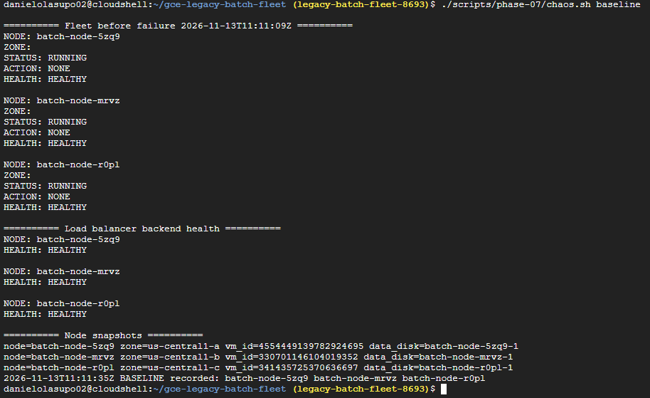
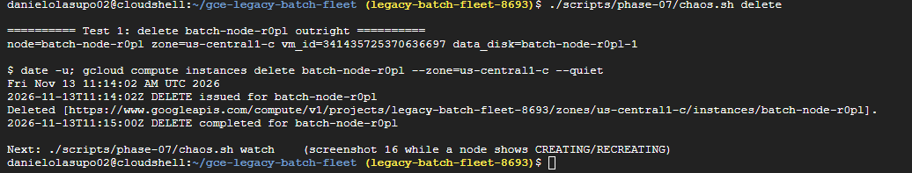
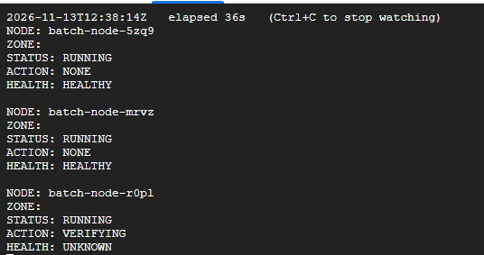
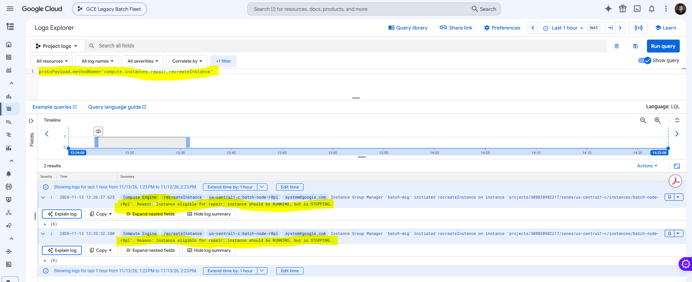
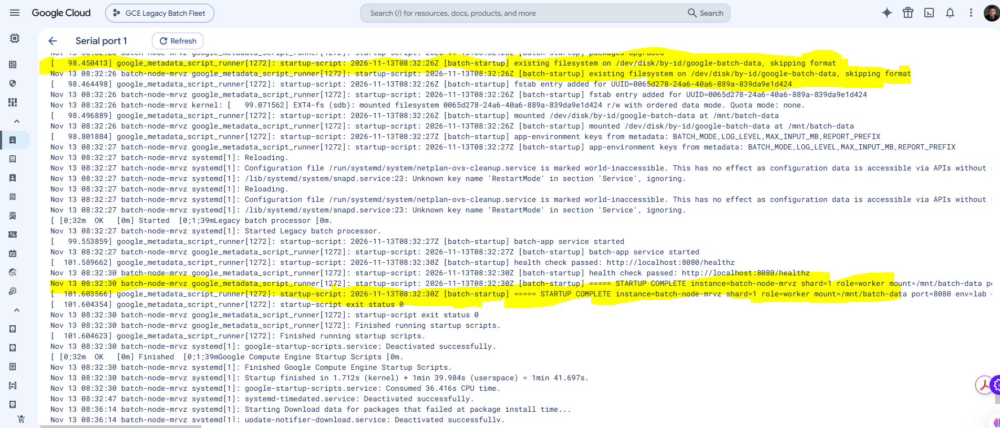
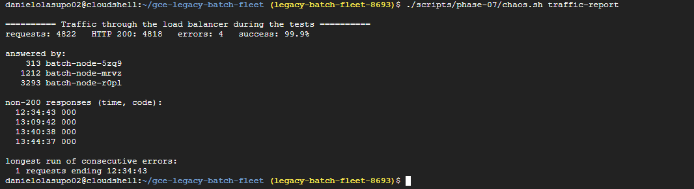
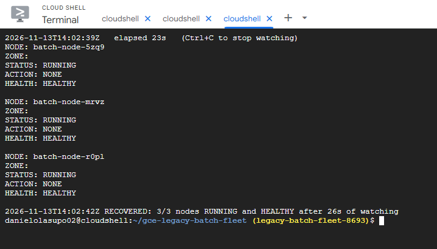
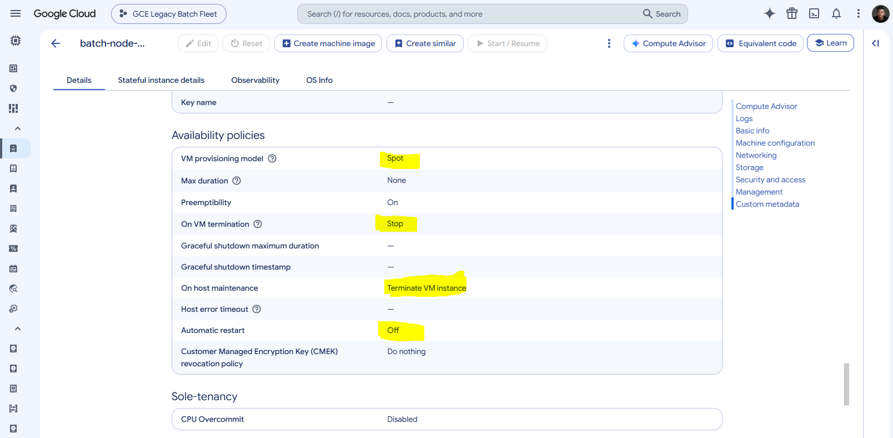
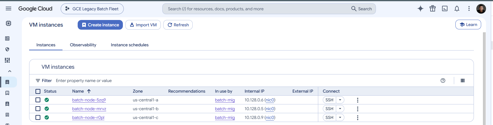

# Phase 7: Verification & Stress Testing

## Objective
Prove that the fleet heals itself without anyone logging in. Two failures are
injected while live traffic flows through the load balancer: a VM deleted
outright, and a VM whose application stops while the VM keeps running. For
each one, measure how long recovery takes, confirm the replacement boots
through the startup script and mounts the persistent disk, and check whether
the node's data and per-node configuration survive. The stretch goals, Spot
VMs and cross-zone distribution, are verified the same way.

## What Was Built
- `scripts/phase-07/chaos.sh`: baseline, live traffic, two failure tests, a live recovery view, a per-test report, Cloud Logging queries and a traffic summary
- `scripts/phase-07/cleanup-check.sh`: confirms nothing billable is left after `terraform destroy`
- `use_spot` Terraform variable switching the template's provisioning model between `STANDARD` and `SPOT`
- `~/phase07-timeline.log` and `~/phase07-traffic.log`: timestamps and per-second traffic results, quoted below

## Configuration

### Test plan

| # | Test | How | What it proves |
|---|---|---|---|
| 1 | Delete a VM | `gcloud compute instances delete <node>` | The MIG restores its target size when a VM disappears |
| 2 | Stop the app | `systemctl stop batch-app` on a running VM | The **health check** drives auto-healing, not just VM existence |
| 3 | Spot preemption (stretch) | `gcloud compute instances simulate-maintenance-event` on a Spot VM | Preempted Spot capacity is restored automatically |

**Why two failure tests and not one?** Deleting a VM only shows that the MIG
keeps three VMs. A VM can be running while the application on it is hung,
crashed or missing its disk. That is the failure auto-healing exists for, and
only the second test exercises the health check → unhealthy → recreate path.

### Targets

| Test | Default target | Why |
|---|---|---|
| Delete | 3rd node by name (shard 2) | Different node from test 2; never the primary |
| Stop the app | 2nd node by name (shard 1) | Different zone from test 1 |

### Expected timeline (stop-the-app test)

| Time | Event |
|---|---|
| T+0 | `batch-app` stopped, port 8080 stops answering |
| T+~30 s | 3 failed probes × 10 s: node UNHEALTHY, load balancer stops sending it traffic |
| T+~30 s | MIG starts recreating the node (same name, `RECREATE`) |
| T+~1 min | New VM running, startup script begins |
| T+3–6 min | Disk mounted, app started, 2 passing probes: node HEALTHY and back in rotation |

### Live traffic
A second Cloud Shell tab sends one request per second to the load balancer
throughout the tests and records the status code and which node answered.
`chaos.sh traffic-report` summarises it: total requests, errors, and the
longest run of consecutive errors.

### Spot VMs (stretch goal)

| Setting | Standard | Spot |
|---|---|---|
| `provisioning_model` | `STANDARD` | `SPOT` |
| `preemptible` | `false` | `true` |
| `automatic_restart` | `true` | `false` |
| `on_host_maintenance` | `MIGRATE` | `TERMINATE` |
| `instance_termination_action` | n/a | `STOP` |

**Why Spot fits this workload?** Batch nodes are interchangeable, keep their
output on a stateful disk, and are replaced automatically by the MIG. Spot VMs
cost a fraction of the standard price in exchange for Google being able to
reclaim them at any time. That is a good trade for non-critical batch
capacity and a bad one for a single latency-sensitive server.

**Why `STOP` instead of `DELETE` on preemption?** A stopped Spot VM keeps its
boot and data disks attached, so bringing it back is a restart rather than a
rebuild. The startup script still runs, but on a disk that is already
formatted and packages that are already current, so recovery is faster.

**Why the whole fleet and not a mix?** Every node here runs the same
non-critical batch work. A production fleet would usually keep a standard
baseline and add Spot capacity on top, using two MIG versions with different
templates.

### Cross-zone distribution (stretch goal)
Delivered in Phase 4 with the regional MIG across `us-central1-a`, `-b` and
`-c`. It is verified at three levels:

| Level | Evidence |
|---|---|
| Nodes are spread across zones | VM list: `batch-node-5zq9` in `us-central1-a`, `batch-node-mrvz` in `us-central1-b`, `batch-node-r0pl` in `us-central1-c`, all in `batch-mig` |
| The MIG enforces the spread | `distributionPolicy`: zones `a`, `b`, `c`, target shape `EVEN` |
| The fleet survives losing a zone's node | Traffic kept flowing from the other two zones while one node was recreated |

**What this cannot show:** a whole zone cannot be taken down on purpose in
Google Cloud. Losing the only node in one zone while the other two zones carry
the traffic is the closest practical test. In a real zone outage the regional
MIG would also rebuild the lost node in one of the remaining zones.

### Cost
No new resources. Spot pricing, if enabled, lowers the VM cost for the rest
of the lab. Everything is removed at the end with `terraform destroy`.

### Commands
The full command set is in [`scripts/phase-07/`](../scripts/phase-07/) and
[`terraform/`](../terraform/):

| File | What it does |
|---|---|
| [`chaos.sh`](../scripts/phase-07/chaos.sh) | `baseline`, `traffic`, `delete`, `kill-app`, `watch`, `report`, `logs`, `traffic-report`, `spot-preempt` |
| [`cleanup-check.sh`](../scripts/phase-07/cleanup-check.sh) | Lists any instances, disks, groups, templates, rules, addresses or routers left |
| [`main.tf`](../terraform/main.tf) | Spot-aware `scheduling` block |
| [`variables.tf`](../terraform/variables.tf) | `use_spot` (default `false`) |

```bash
# Tab 2
./scripts/phase-07/chaos.sh traffic

# Tab 1
./scripts/phase-07/chaos.sh baseline
./scripts/phase-07/chaos.sh delete
./scripts/phase-07/chaos.sh watch
./scripts/phase-07/chaos.sh report
./scripts/phase-07/chaos.sh kill-app
./scripts/phase-07/chaos.sh watch
./scripts/phase-07/chaos.sh report
./scripts/phase-07/chaos.sh logs
./scripts/phase-07/chaos.sh traffic-report

# Stretch: Spot
terraform -chdir=terraform plan -var use_spot=true -out=spot.tfplan
terraform -chdir=terraform apply spot.tfplan
./scripts/phase-06/rollout.sh
./scripts/phase-07/chaos.sh spot-preempt
./scripts/phase-07/chaos.sh watch

# Cleanup
terraform -chdir=terraform destroy
./scripts/phase-07/cleanup-check.sh
```

## Verification

| Check | Command | Result |
|---|---|---|
| Baseline: 3 nodes healthy | `chaos.sh baseline` | _pending_ |
| Delete: MIG restores the node | `chaos.sh delete`, `watch` | _pending_ |
| Delete: recovery time | `~/phase07-timeline.log` | _pending_ |
| Delete: same name, data disk, shard | `chaos.sh report` | _pending_ |
| Stop app: node marked unhealthy | `chaos.sh logs` (health state changes) | _pending_ |
| Stop app: auto-healing repair event | `chaos.sh logs` (`repair.recreateInstance`) | _pending_ |
| Stop app: recovery time | `~/phase07-timeline.log` | _pending_ |
| Stop app: data disk and marker kept, no reformat | `chaos.sh report` | _pending_ |
| Startup script ran on replacement, disk mounted | `chaos.sh logs` (startup lines) | _pending_ |
| Traffic during failures | `chaos.sh traffic-report` | _pending_ |
| Cross-zone: nodes in three zones | VM instances list | `batch-node-5zq9` (`us-central1-a`), `batch-node-mrvz` (`us-central1-b`), `batch-node-r0pl` (`us-central1-c`), all in `batch-mig` |
| Cross-zone: MIG distribution policy | `gcloud compute instance-groups managed describe batch-mig --region=us-central1 --format="yaml(distributionPolicy)"` | _pending_ |
| Cross-zone: other zones served during recovery | `chaos.sh traffic-report` (answered by) | _pending_ |
| Spot: provisioning model `SPOT` | `gcloud compute instances describe <node> --format="value(scheduling.provisioningModel)"` | _pending_ |
| Spot: preempted node restored | `chaos.sh spot-preempt`, `watch` | _pending_ |
| Nothing left after destroy | `cleanup-check.sh` | _pending_ |

### Screenshots

**Before failure: three healthy nodes**


**Deleting a node**


**MIG recreating the deleted node**


**Auto-healing repair after the app stopped**


**Startup script on the replacement node**


**Load balancer kept serving through the failures**


**Back to three healthy nodes**


**Spot provisioning model (stretch)**


**Nodes spread across three zones (stretch)**


## Notes & Issues

### Issue: missed the node mid-recreation for screenshot 16
**Symptom:** By the time the MIG page was opened after the first delete test,
all three nodes already showed as healthy, so there was no recreating node to
capture.

**Cause:** `chaos.sh delete` waits for the delete to finish, and the MIG starts
recreating the VM almost immediately. The node then sits in `VERIFYING` for a
few minutes while it boots, but the console was opened after that window had
closed.

**Fix:** Re-ran the delete test with the MIG page already open, and chained the
watch straight after the delete:
```bash
./scripts/phase-07/chaos.sh delete && ./scripts/phase-07/chaos.sh watch
```
The node showed `CREATING` and then `VERIFYING`, and was captured. Both runs
are in `~/phase07-timeline.log`.

**Lesson:** For evidence of a short-lived state, have the view open before
triggering the event.

### Issue: Terraform plan failed with `connection refused`
**Symptom**
```
Error: Error when reading or editing Instance Template "batch-node-template-...":
Get "https://compute.googleapis.com/compute/v1/projects/legacy-batch-fleet-8693/global/instanceTemplates/...":
dial tcp 74.125.71.95:443: connect: connection refused
```

**Cause:** A transient network failure between Cloud Shell and the Compute
Engine API. The connection was refused before the request reached the
project: most resources refreshed normally in the same run and only two
requests failed.

**Fix:** Re-ran the plan. A failed plan changes nothing, so retrying is safe.

**Lesson:** `connection refused` or `dial tcp` errors are about the network
path, not permissions or configuration. Retry before debugging the code.

### Issue: startup script lines missing from Cloud Logging
**Symptom**
```
resource.type="gce_instance"
labels."compute.googleapis.com/resource_name"="batch-node-mrvz"
"batch-startup"

0 results
Showing logs for last 12 hours
```

**Cause:** The startup script ran on the replacement node (`chaos.sh report`
showed the disk mounted and the app healthy), but its output only went to the
VM's serial console and the systemd journal. The Ubuntu guest agent did not
forward startup script output to Cloud Logging. The same query had returned
nothing in Phase 3; that was put down to the time range at the time, but this
was the real cause.

**Fix:** Added `serial-port-logging-enable = "TRUE"` to the instance template
metadata, which streams each VM's serial console to Cloud Logging under
`serialconsole.googleapis.com/serial_port_1_output`. Applied the new template
and re-ran the stop-the-app test, so the auto-healed replacement booted with
the new metadata and its startup lines appeared in Logs Explorer.

**Lesson:** Check that logs actually reach the logging backend early, with one
known-good line, before relying on them as evidence. "The script ran" and
"the logs are where I expect them" are separate facts.

### Decision: never target the primary node by default
The node with shard 0 has the `primary` role. Tests default to the 2nd and
3rd nodes so each failure hits a worker in a different zone. Either target can
be overridden, for example `chaos.sh kill-app batch-node-5zq9`.

### Decision: a marker file on the data disk before each test
Each test writes a timestamped file to `/mnt/batch-data/state/` before the
failure. `chaos.sh report` checks for it on the replacement node. If it is
there and the startup log says `skipping format`, the stateful disk survived;
if it is missing, the replacement got a fresh disk.

### Decision: pass `use_spot` on every command once Spot is on
`use_spot` defaults to `false`. After switching the fleet to Spot, every
`plan`, `apply` and `destroy` needs `-var use_spot=true`, or Terraform plans a
new template that switches the fleet back to standard VMs. A production setup
would set it in `terraform.tfvars` instead of on the command line.

### Decision: check for leftovers after destroy
Stateful disks are designed to outlive VMs. `ON_PERMANENT_INSTANCE_DELETION`
should remove them when the MIG is destroyed, and `cleanup-check.sh` confirms
it instead of trusting it.